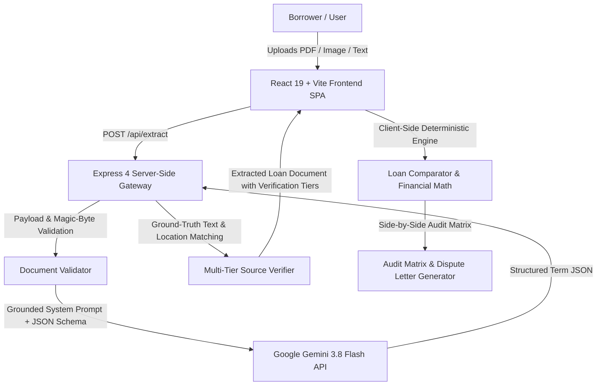

# LoanLens — Check Before You Sign

**LoanLens** is an open-source fintech web application designed for Indian retail borrowers (home loans, personal loans, loans against property) to systematically cross-audit their loan documents before signing.

In retail lending across India, commercial terms frequently vary between initial pre-contract disclosures (**Key Facts Statement (KFS)** or **Sanction Letter**) and the lengthy (25–40 page) execution draft of the **Loan Agreement**—including external benchmark spreads, upfront administrative charges, ancillary credit insurance bundling, and penal clauses.

LoanLens automatically extracts, normalizes, and cross-evaluates **9 core loan terms** across all three document types, verifying contractual clause references against ground-truth document text, applying Reserve Bank of India (RBI) regulatory circulars, and generating a formal clarification letter for borrowers to present to their lending institution.

---

## Architecture & Request Data Flow



1. **Intake & Validation:** The browser client captures files (PDF, images, TXT) and validates file boundaries (authentic `%PDF` header magic bytes, minimum text lengths).
2. **Server-Side Extraction:** The Express backend calls Gemini 3.8 Flash (`@google/genai`) using a strict JSON schema and low temperature (`0.1`) to ensure deterministic extraction.
3. **Ground-Truth Source Verification:** The server-side verifier cross-checks every extracted excerpt against actual document text using full-substring and sequential ellipsis-segment matching, assigning an explicit evidence tier and citation location status.
4. **Deterministic Client-Side Comparison:** The browser runs client-side comparison, unit normalization, and reducing-balance financial math without storing documents on disk or making unneeded API calls.

---

## Core Capabilities & Technical Guarantees

### 1. Unmistakable Demo Mode & Data Isolation
- **Persistent Sample Indicators:** When viewing pre-computed demonstration profiles (e.g. Vikramaditya Sharma or Pooja Iyer), the top navbar displays a `Sample Data Mode` badge, upload cards carry `Synthetic Sample` badges, and the comparison view presents a `Synthetic Demonstration Mode Active` banner.
- **Strict Data Isolation:** Demo data and real user documents are strictly isolated. Uploading a real document automatically purges demo slots. LoanLens requires at least two real documents before generating an authentic audit, and will never evaluate real documents against synthetic benchmarks.

### 2. Multi-Tier Source Verification & Location Provenance
LoanLens never presents an AI excerpt as verified source evidence unless it has been corroborated against ground-truth text:
- **`source_verified`:** The numeric value matches under token boundary rules, and the complete excerpt is corroborated against actual document text via normalized full-substring or sequential ellipsis-segment matching (`isVerifiedInSource === true`).
- **`excerpt_corroborated`:** The numeric value matches the AI excerpt, but underlying source text is unavailable (e.g. binary/scanned PDFs or images sent directly to Gemini multimodal without local OCR text). The UI explicitly displays *"AI-extracted — source not independently verified"* (`isVerifiedInSource === false`).
- **`ai_extracted`:** The excerpt or value was generated by AI without independent corroboration or was not found in the source text.
- **`unverified`:** Citations or excerpts are missing, placeholder (`"Not mentioned"`), negative (`"Not detected"`), or contradict extracted numbers.
- **Decoupled Location Provenance:** Clause and page references are verified independently from text excerpts, assigning statuses of `verified`, `ai_reported`, or `unpaginated_source`.

### 3. Rigorous Regulatory Auditing (RBI & IRDAI Citations)
All claims are grounded in verified circular identifiers, issue dates, official URLs, and specific applicability conditions:
- **KFS Mandate:** RBI Circular `RBI/2024-25/18 DOR.MCS.REC.17/01.01.001/2024-25` (Mandatory Key Facts Statement for retail and MSME loans).
- **Penal Charges vs. Penal Interest:** RBI Circular `RBI/2023-24/53 DoR.MCS.REC.28/01.01.001/2023-24` (Requires reasonable flat penal charges; prohibits compounding of penal interest).
- **Foreclosure Charges:** RBI Circular `DBOD.Dir.BC.115/13.03.00/2013-14` (Prepayment penalties waived for individual retail borrowers on floating-rate term loans).
- **Ancillary Insurance Bundling:** IRDAI `IRDAI/NL/GDL/MISC/10/2024` & RBI Fair Practices Directions (Prohibits coercive bundling of insurance as a condition precedent).
- **External Benchmark Linked Rate (EBLR):** RBI Circular `DBR.Dir.BC.No.14/13.03.00/2019-20`.

### 4. Deterministic Financial Math & Unit Reconciliation
- **Reducing-Balance EMI Calculation:**
  $$E = P \cdot r \cdot \frac{(1+r)^n}{(1+r)^n - 1}$$
- **Zero Hallucination of Missing Values:** If principal, interest rate, or tenure inputs are missing, LoanLens states *"Lifetime impact cannot be computed because required parameters are missing"* rather than inventing estimates or displaying misleading ₹0 figures.
- **Unit Normalization:**
  - **Tenure:** Reconciles years and months (e.g., "20 Years" in KFS matches "240 Months" in Loan Agreement).
  - **Interest Rate:** Normalizes monthly rates (% p.m.) to annualized percentages (% p.a.).
  - **Principal:** Normalizes Lakhs and Crores to exact INR numbers.

### 5. Privacy, Storage & Security
- **In-Memory Processing:** Uploaded files and extracted terms are processed transiently in server memory and client browser state.
- **Zero Persistent Disk Storage:** No borrower documents, PDF files, images, or extracted terms are saved to server disks or databases.
- **No Secret Leaks:** All API keys are loaded via environment variables and never exposed to client-side bundles.

---

## Supported Documents & Input Formats

| Document Type | Role | Typical Formats |
| :--- | :--- | :--- |
| **Key Facts Statement (KFS)** | RBI-mandated standardized summary sheet with APR, fees, and schedule | PDF, TXT, PNG, JPG (Max 25MB) |
| **Sanction Letter** | Formal approval letter communicating sanctioned limit and conditions | PDF, TXT, PNG, JPG (Max 25MB) |
| **Loan Agreement** | Detailed execution contract draft containing covenants and clauses | PDF, TXT, PNG, JPG (Max 25MB) |

*Single-Source Multi-Section Support:* If a borrower uploads a single combined package (e.g. Sanction Letter and Agreement bound together), LoanLens scans the file across all slots while explicitly displaying a Single-Source Multi-Section attribution notice.

---

## Local Development & Setup

### Prerequisites
- Node.js 20+
- npm 10+
- Google Gemini API Key (optional for synthetic demo and offline test suite; required for live document extraction)

### 1. Clone & Install
```bash
git clone https://github.com/Darkm0nk/LoanLens.git
cd LoanLens
npm install
```

### 2. Configure Environment
```bash
cp .env.example .env
```
Edit `.env` to configure your Gemini API Key:
```env
GEMINI_API_KEY="your-gemini-api-key-here"
PORT=3000
NODE_ENV=development
```

### 3. Start Application
```bash
npm run dev
```
Open [http://localhost:3000](http://localhost:3000) in your browser.

### 4. Build for Production
```bash
npm run build
npm start
```

---

## Verification & Test Suite

The LoanLens codebase is covered by deterministic unit, integration, and browser test suites:

### 1. Quality, Data-Isolation & Audit Report Test Suite (90 Tests)
```bash
npm test
```
Executes three comprehensive offline test suites without consuming Gemini API tokens:
- **`test/comparator.test.ts` (63 Tests):**
  - Financial math: reducing-balance EMI, zero-percent interest, missing input rejection, lifetime impact.
  - Matching & mismatch detection: 9 core terms, unit reconciliation (years vs. months, % p.m. to % p.a., Lakhs/Crores).
  - Document validation: %PDF magic bytes, payload length guards, text length guards.
  - AI failure handling: malformed JSON, missing fields, schema validation.
  - Regulatory grounding: RBI circular links, non-inflammatory language.
  - Regulatory status regression: `isRbiCompliant: null` and `isFloatingNilExempt: null` producing explicit `not_assessed` states, contradictory penal/prepayment clause detection.
  - Multi-tier source verification: token boundaries, contextual processing fee corroboration, full-substring/ellipsis-segment matching, location provenance decoupling.
  - Adversarial checks: fabricated prefix rejection, truncated excerpt failure, unrelated percentage rejection.
- **`test/data-isolation.test.ts` (13 Tests):**
  - Data isolation guards: throws on demo/real mixing.
  - Minimum 2-real-document requirement.
  - Demo-to-real purge simulation.
  - Replacement integrity and stale report invalidation on document clearing.
  - ₹0 missing value formatting prevention.
  - Single-sample loading & mixed-state prevention guards.
- **`test/audit-report-printer.test.ts` (14 Tests):**
  - Report structure: headers, synthetic demo banners vs. confidential client badges.
  - 9-term audit matrix generation with value tables, clause citations, and evidence badges.
  - Financial impact calculations, calculation assumptions, and regulatory directives.
  - HTML escaping, injection prevention, and non-browser safe execution.

### 2. TypeScript Lint & Typecheck
```bash
npm run lint
```
Executes `tsc --noEmit` with zero errors.

### 3. Production Bundle Build
```bash
npm run build
```
Executes Vite production build and assets packaging.

### 4. End-to-End Headless Browser UI Tests (Playwright - 6 Tests)
```bash
npm run test:ui
```
Executes 6 automated browser journeys in headless Chromium:
1. Navigation across Overview, Intake & Comparison, and RBI Guide tabs.
2. Dynamic borrower avatar derivation and Sample Data Mode header pill.
3. Upload error notification handling and dismiss button action.
4. Aligned term verification with emerald status badges and Aligned modal header.
5. Single-document intake guard: resetting and loading 1 document displays awaiting notice.
6. Print Audit Report vs Clarification Notice separation and isolated iframe printing.

### 5. Optional Live Gemini API Integration Test
```bash
npm run test:e2e
```
*Note: Requires valid `GEMINI_API_KEY` and running local server on port 3000.*

---

## Known Limitations & Troubleshooting

- **Gemini Free-Tier Rate Limits (HTTP 429):** Free-tier Gemini keys have rate limits (e.g. 15 requests per minute). If quota is exceeded, LoanLens responds with a `GEMINI_QUOTA_EXCEEDED` message and skips automatic retries to avoid wasting quota. You can continue testing using pre-computed synthetic demo cases.
- **Scanned Image / Raster PDFs:** Scanned image-only PDFs sent to Gemini multimodal are extracted accurately, but because raw machine-readable text is not extracted on the client, they are classified under the `excerpt_corroborated` tier rather than `source_verified`.
- **Regulatory Disclaimers:** A contractual variance between a pre-sanction offer and loan agreement does not prove fraud or regulatory non-compliance. Terms may adjust during underwriting due to risk assessment or benchmark reset dates. LoanLens recommends clarifying all variances with the lending institution.
